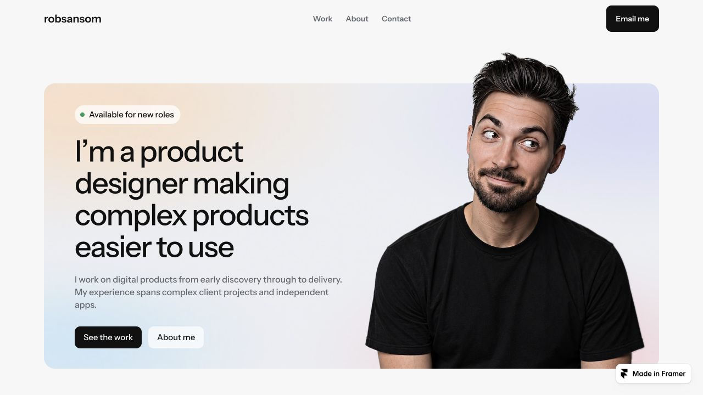
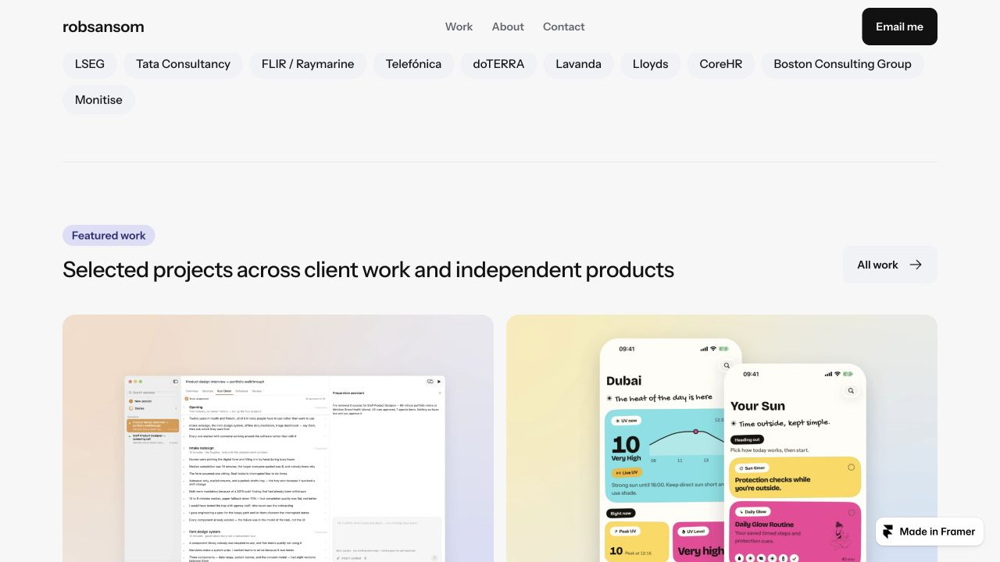
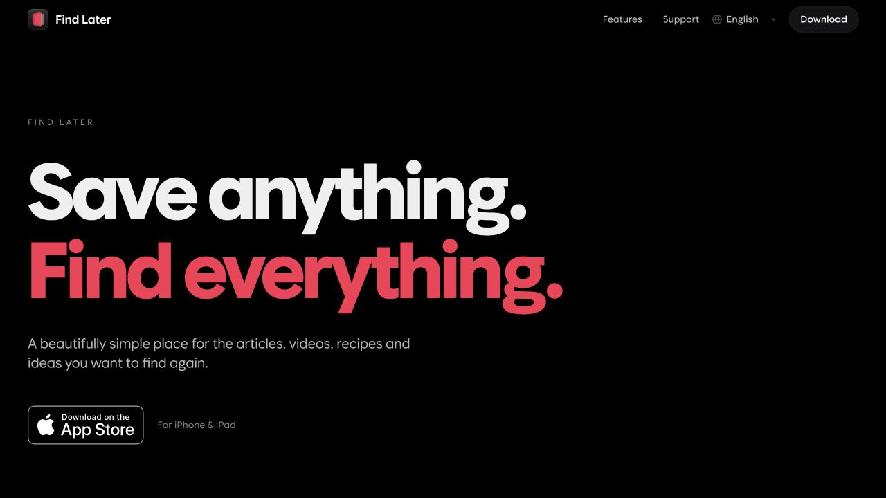
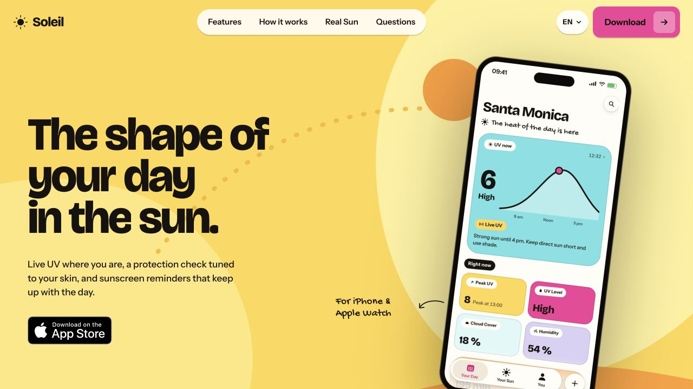
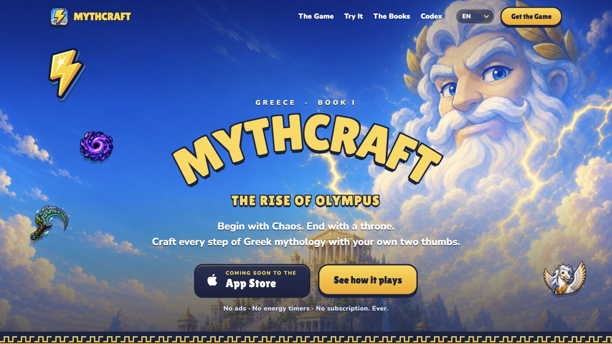
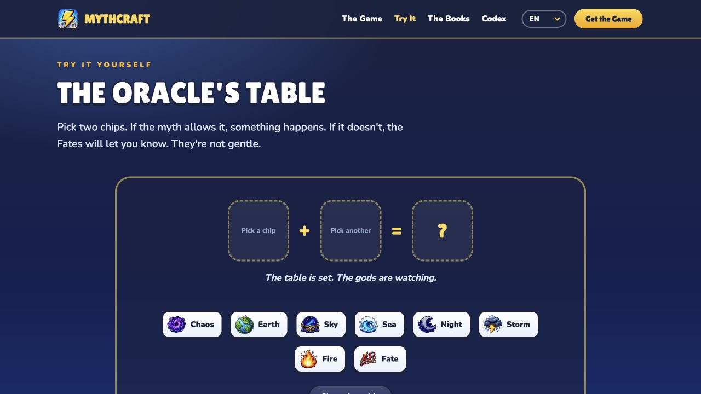
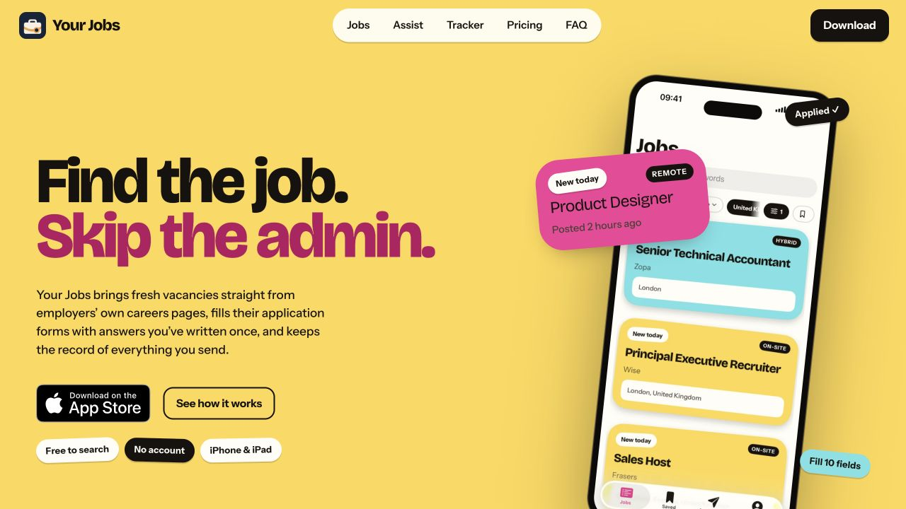

# Sansom Studio — existing website references

Reviewed 28 October 2026. Working name: Sansom Studio. Intended hosting: GitHub Pages. The recommendations below are proposals, not an approved design or migration.

## 1. Design portfolio — strong reference for the studio's shared presentation

Source: https://robsansom.framer.website/

The desktop homepage uses a light neutral background, generous margins, simple navigation, rounded image panels and restrained typography. Its project grid gives the products substantial visual space. Carry these qualities into the studio catalogue, with a shorter introduction that gets visitors to the apps quickly.

## 2. Find Later — established, distinct visual identity

Source: https://getfindlater.com/ and ../Pouch3 Website.

The captured desktop hero uses black, white and red with oversized typography. Existing sections show saved cards, collections, iPad layouts, export and system integration. A studio product page should retain the recognisable library imagery and explain the save–organise–find workflow. Prioritise a real product visual near the headline when adapting the page.

## 3. Soleil — established, colourful product presentation

Source: https://getsoleilapp.com/. Several local Sunkind Website copies exist; the production checkout has not been resolved in this review.

The desktop hero uses yellow, pink, an expressive headline and a prominent phone capture. Retain its colour and real product screens. Focus the product story around checking UV, organising protection and reviewing daylight. Its existing guides can remain separate supporting pages.

## 4. MythCraft — strong game identity and distinctive demo section

Source: ../mythcraft-website, rendered locally without modifying source files.

The hero uses illustrated mythology, blue skies, outlined display lettering and gold buttons. The Oracle's Table presents a small crafting interaction. Preserve the game artwork and consider retaining this section as an optional custom module within the shared product-page system. The demo section was reached through the navigation, but crafting combinations were not exercised.

The README records a GitHub Pages deployment at https://robsansom.github.io/MythCraft/. Public availability was not confirmed by this review. The local page displays Coming Soon; this is not verification of App Store release status.

## 5. Your Jobs — complete product story, suitable for editorial shortening

Source: ../Job Search App Landing Page, rendered locally without modifying source files.

The site is branded Your Jobs. Its yellow, pink and cyan presentation is closely related to Soleil. It already contains a full one-page marketing story plus separate support, privacy and terms pages. A shorter version can group its story into finding roles, completing forms with saved answers, and tracking applications, using the existing captures.

The README records placeholder support details and a privacy-link mismatch requiring attention before publication. These are source notes, not an audit of current App Store configuration. Public hosting and app release status were not confirmed.

## Proposed site structure

A calm studio catalogue, inspired by the portfolio, leads to a dedicated scrolling product page for every app. Shared modules handle the introduction, screenshot gallery, features, pricing/status, FAQ and links to support/privacy/terms. Optional modules preserve an app's distinctive demo or story. Each product can supply its accent colour, art and imagery while sharing navigation, spacing, readable body typography and legal layouts.

New apps should usually require an app record and assets. A custom interactive section is an optional enhancement, not a prerequisite for adding an app. Existing landing pages are source material; shorten repeated explanations while preserving material product differences, useful demos and supporting content.

## Evidence limits

This was a desktop visual reference review, not a full usability, accessibility, content-accuracy or release audit. Screenshots were captured at 1280 × 720. Mobile layouts, keyboard operation, contrast ratios, reduced motion, all links and full interactions remain untested. Small secondary text and expressive typography deserve checks when adapted. No existing app or website source was edited, migrated or deployed.
